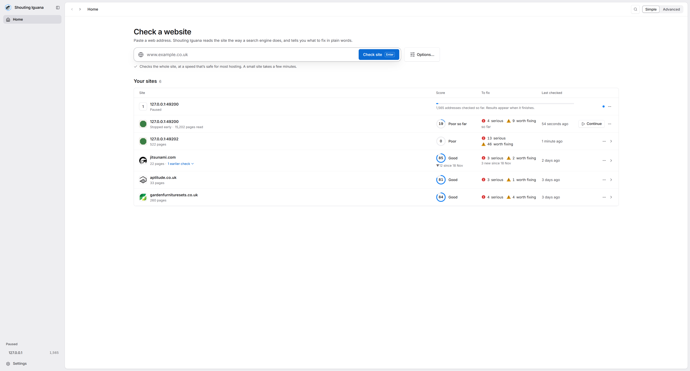
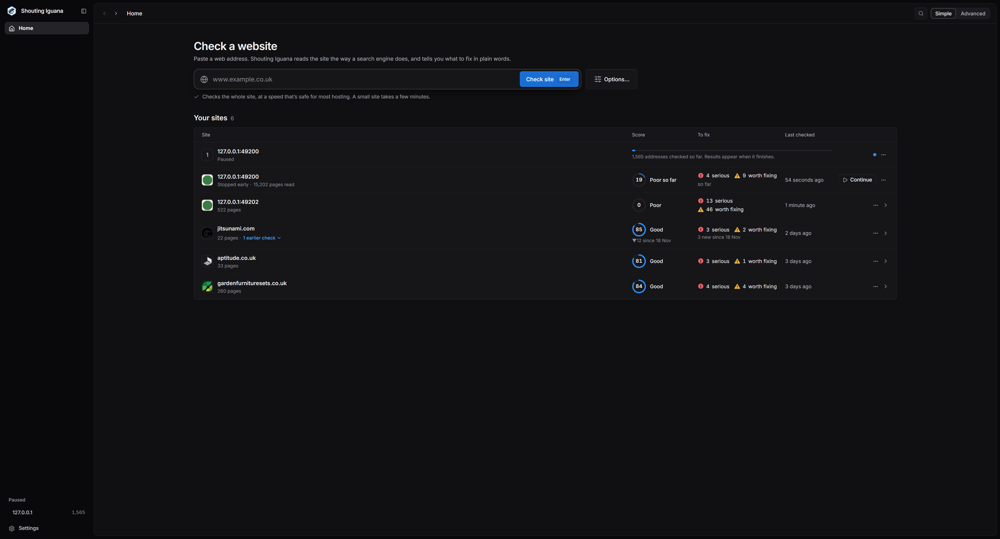
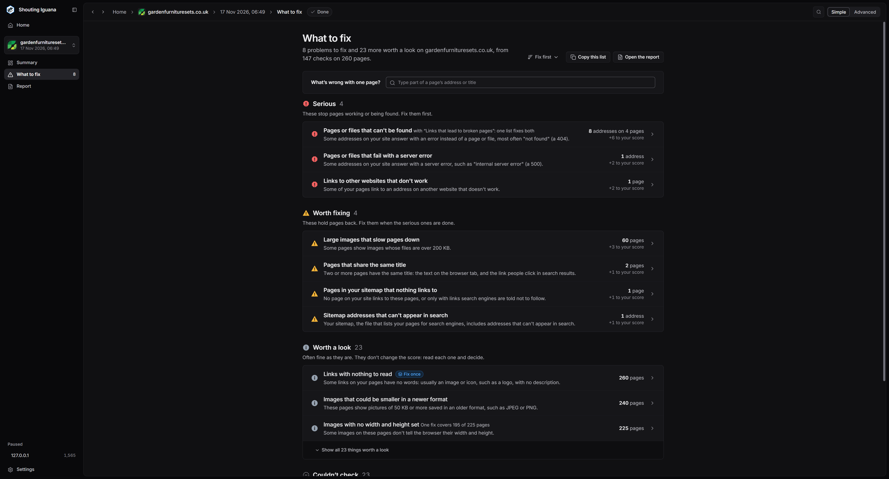
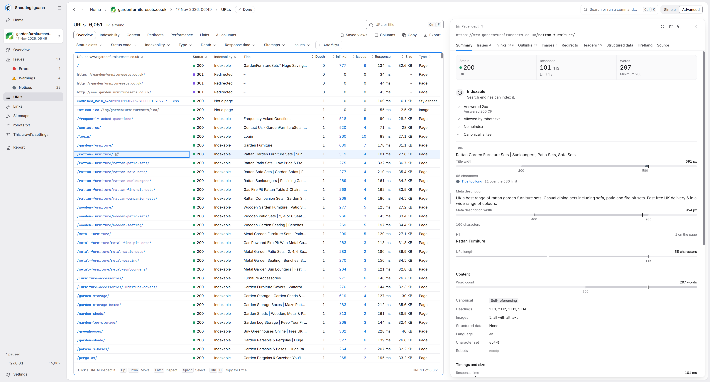
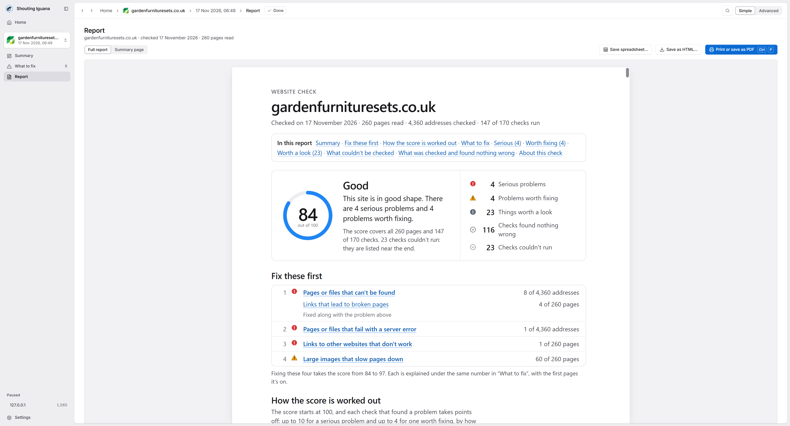

# Shouting Iguana


**See your site the way a search engine does. Know exactly what to fix.**

Shouting Iguana is a desktop SEO crawler. It crawls every URL it can reach, scores the site, and puts the issues that move the needle at the top. Broken links, redirect chains, pages search engines will not index, duplicate content, titles and descriptions that get cut off in the results. Each one says what is wrong, why it matters, and how to fix it.

Hand the report to a client. Or fix it yourself, then recheck just those pages and watch the score move.

**2.0.1** for Windows, macOS and Linux. Your crawl stays on your machine. No account. No plugin to install.

**[Download 2.0.1](https://github.com/YodasMyDad/ShoutingIguana/releases/tag/app-v2.0.1)**

This release is the full v2 app. It renders pages a script builds, reads a host in a browser when plain HTTP is blocked, crawls a list of addresses, pulls out text you name, and signs in over HTTP, with a cookie, or through a form.

## Why people download it

- **A crawl you can act on.** Not a spreadsheet of ten thousand rows. A score, then the issues worth fixing first, with the fix written out.
- **The full audit when you need it.** Simple is the client view. Advanced is one switch away: every URL, the link graph, XML sitemaps, robots.txt, and an inspector for a single address.
- **Prove the fix.** Recheck the pages you changed. The score and the issue list update against the previous crawl.
- **Yours, offline.** One `.sicrawl` file per site. Nothing is uploaded.
- **Pages a script builds.** The default renders a page only when its HTML is an empty shell. Render every HTML page, only the URLs you name, or none. When every page is rendered, a link that was only in the raw HTML is still followed.
- **A list, not the whole site.** Paste addresses, or a CSV with a Url column. Those pages are read. Links on them are recorded and not followed.
- **Text you define.** Name a rule and give it a CSS selector, an XPath expression, or a regular expression. The crawl reads each page once and keeps what matches. Simple and Advanced both list the values.

## Screenshots

### Start a crawl in seconds

Enter a URL, or reopen a site you already audited. The score and what is still outstanding are on the row.

| Light | Dark |
| --- | --- |
|  |  |

### The issues worth fixing first

Errors, then warnings, then notices. Each line is the issue, how many URLs it hits, and what fixing it does to the score.

| Light | Dark |
| --- | --- |
|  |  |

### A fix you can hand to a developer

Open an issue and the fix is at the top: what to change, and where. A header link repeated across the site is one fix, not one ticket per page.

| Light | Dark |
| --- | --- |
|  |  |

### Inspect any URL

Advanced. Open a crawled URL and see the response, whether search engines can index it, the title and headings, the links in and out, and the issues on that URL alone.

| Light | Dark |
| --- | --- |
|  |  |

### A report you can send

The audit as a document: the score, what to fix first, and how the score was calculated. Save it, or print it for the client.

| Light | Dark |
| --- | --- |
|  |  |

## Downloads

Installers are on the GitHub release [app-v2.0.1](https://github.com/YodasMyDad/ShoutingIguana/releases/tag/app-v2.0.1).

| System | File |
| --- | --- |
| Windows | NSIS installer, 64-bit, per user |
| macOS | Disk image for Apple silicon (arm64), and one for Intel (x64) |
| Linux | `.deb` and AppImage, 64-bit |

Each file has a SHA256 checksum (`SHA256SUMS-*.txt` on the release).

## Opening an unsigned build

This beta is not code-signed. Windows and macOS warn the first time you open it.

### Windows (SmartScreen)

1. If the installer is blocked because it came from the internet: right-click it, **Properties**, tick **Unblock**, then **OK**.
2. Run it. If SmartScreen says Windows protected your PC, choose **More info**, then **Run anyway**.
3. The app can show the same prompt the first time it starts. **More info**, then **Run anyway**.

Some managed PCs block unsigned installers. That is the organisation's policy.

### macOS (Gatekeeper)

1. Open the disk image. Apple silicon (M1 and later) uses the arm64 image. An Intel Mac uses the x64 image.
2. Drag **Shouting Iguana** to **Applications**.
3. The first open is blocked, because Apple cannot check the developer. Control-click the app, choose **Open**, then **Open** again.
4. The same choice is in **System Settings → Privacy & Security**, as **Open Anyway**, next to the block message.

### Linux

The `.deb` and the AppImage are unsigned. Install the `.deb` with your package manager, or mark the AppImage executable and run it. The `.deb` needs the system's `libicu`, which apt installs with WebKit. The AppImage already contains it.

## A first crawl

1. Open the app. It starts in Simple.
2. Enter the site address and choose **Check site**. The default crawl rate is polite.
3. When the crawl finishes, **What to fix** lists errors first.
4. Open an issue. The text says what to change and where. **Recheck these pages** fetches those URLs again.
5. **Report** is the audit as a page you can save or print.
6. **Advanced**, at the top right, is the full URL list. Select a URL to open the inspector.

## What the crawl finds

The same checks run in Simple and in Advanced. This is the technical SEO audit: response codes, indexability, links, content, and the signals search engines actually use.

- Response codes: 4xx and 5xx, timeouts, URLs that refuse the crawler, and resources served as the wrong content type
- Redirect chains, loops, and redirects that do not land on the final URL
- Broken internal and external links
- Indexability: noindex, robots.txt blocks, canonicals that disagree, and canonicals that point at a URL which does not resolve
- Orphan URLs, and pages a sitemap should list but does not
- XML sitemaps: unreadable files, URLs on another host, invalid lastmod, and URLs listed more than once
- Page titles and meta descriptions: missing, duplicate, or the wrong length in pixels, the way the search result cuts them
- Heading structure: missing H1, duplicates, and skipped levels
- Thin content, and near-duplicate pages
- Images: broken, oversized, missing alt text, legacy formats, missing dimensions
- Hreflang and language tags that do not agree
- Structured data that is missing or invalid
- HTTPS, mixed content, insecure forms, and weak security headers
- URLs that are too long, duplicated, or easy to confuse
- Slow responses and heavy pages
- HTML issues that change how the page is parsed: language, charset, and broken markup
- Text you asked the crawl to pull out, by CSS selector, XPath, or regular expression

Shouting Iguana flags the issue and explains the fix. It does not change the site.

## Building from source

You need the [.NET 10 SDK](https://dotnet.microsoft.com/download), [Node.js 24](https://nodejs.org/), and Rust (rustup; on Windows, the MSVC toolchain). App notes are in [`app/README.md`](app/README.md). Engine notes are in [`engine/README.md`](engine/README.md).

The engine, from the repo root:

```bash
dotnet test engine/ShoutingIguana.Engine.slnx
dotnet run --project engine/src/ShoutingIguana.Cli -- crawl https://example.com --db example.sicrawl
```

The desktop app:

```bash
cd app
npm ci
npm run build:sidecar
npm run tauri dev      # the app, with the engine started for it
npm run tauri build    # a release build and the installer for this OS
```

## Plugins

The `ShoutingIguana.PluginSdk` NuGet package is no longer used. v2 has no plugin system. The package stays published.

## Licence

[MIT](LICENSE).
