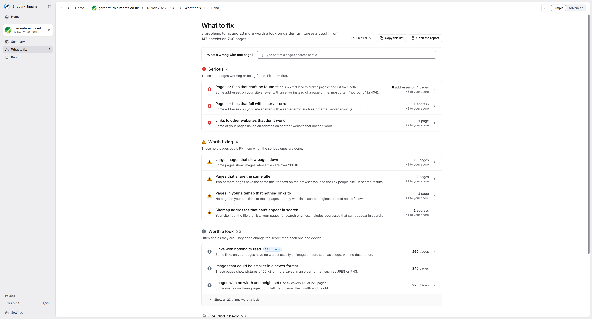
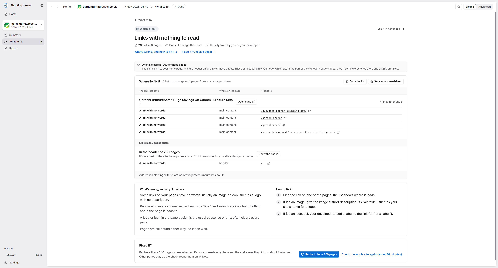
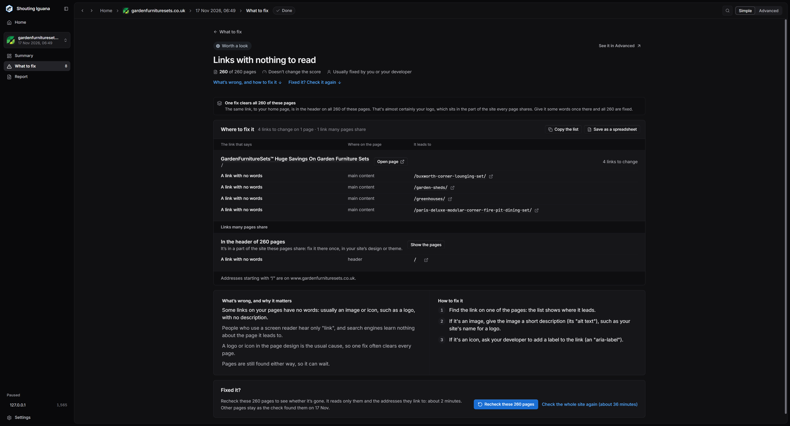
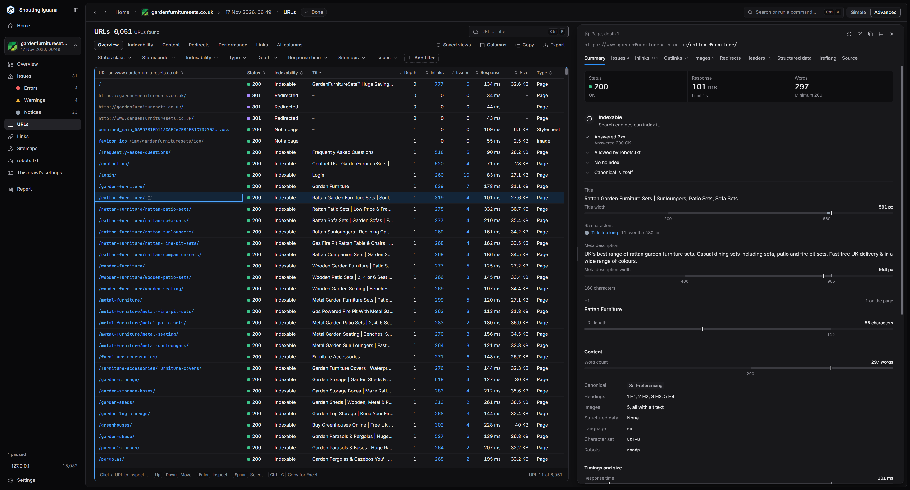
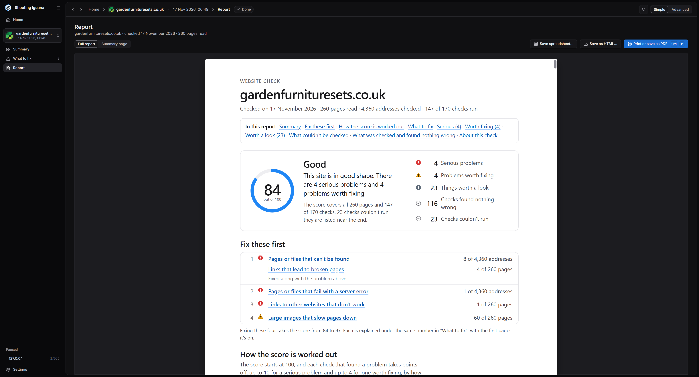

# Shouting Iguana


**See your site the way a search engine does. Know exactly what to fix.**

Shouting Iguana is a desktop SEO crawler. It crawls every URL it can reach, scores the site, and puts the issues that move the needle at the top. Broken links, redirect chains, pages search engines will not index, duplicate content, titles and descriptions that get cut off in the results. Each one says what is wrong, why it matters, and how to fix it.

Hand the report to a client. Or fix it yourself, then recheck just those pages and watch the score move.

**2.1.0** for Windows, macOS and Linux. Your crawl stays on your machine. No account. No plugin to install.

**[Download 2.1.0](https://github.com/YodasMyDad/ShoutingIguana/releases/tag/app-v2.1.0)**

This release is the full v2 app. It renders pages a script builds, retries a blocked host in a real browser, crawls a list of addresses, pulls out text you name, and signs in over HTTP, with a cookie, or through a form.

## Why people download it

- **A crawl you can act on.** Not a spreadsheet of ten thousand rows. A score, then the issues worth fixing first, with the fix written out.
- **The full audit when you need it.** Simple is the client view. Advanced is one switch away: every URL, the link graph, XML sitemaps, robots.txt, and an inspector for a single address.
- **Prove the fix.** Recheck the pages you changed. The score and the issue list update, and each page says fixed or still there. Crawl the site again later and the new crawl is compared with the last one.
- **Yours, offline.** One `.sicrawl` file per crawl. Nothing is uploaded.
- **Pages a script builds.** The default renders a page only when its HTML is an empty shell. Render every HTML page, only the URLs that match a pattern you give, or none. When every page is rendered, a link that was only in the raw HTML is still followed.
- **A blocked host, read in a real browser.** On by default. A site that answers the crawler never starts a browser. One that blocks it is read in the Chrome or Edge on your computer instead, in a window kept out of sight. A browser the crawl needs and the computer doesn't have (a Chromium, when there is no Chrome or Edge) is downloaded then, once, and the crawl says so. That gets past the automatic checks most protected sites use (Cloudflare's "Just a moment", DataDome). If the site wants a person, to tick a box or solve a puzzle, the window opens for you to do it and the crawl carries on. It does not solve a CAPTCHA for you. A site that lets the check read some pages and then starts turning it away is read more slowly by itself, one page at a time, and the pages it turned away are asked again. A site that refuses even a real browser, or still refuses at one page every 30 seconds, stays marked as blocked, with what its owner can do to let the crawler in. To turn it off: "If a site blocks the check" in the crawl's settings, or `si crawl --no-browser-fallback`.
- **A list, not the whole site.** Paste addresses, or a CSV with a Url column. Those pages are read. Links on them are recorded and not followed, and sitemaps are not read.
- **Text you define.** Name a rule and give it a CSS selector, an XPath expression, or a regular expression. The crawl reads each page once and keeps what matches. Simple and Advanced both list the values.

## Screenshots

### Start a crawl in seconds

Enter a URL, or reopen a site you already audited. The score and what is still outstanding are on the row.

| Light | Dark |
| --- | --- |
|  |  |

### The issues worth fixing first

Errors, then warnings, then notices. Each line is the issue, how many URLs it hits, and, for an error or a warning, what fixing it adds to the score.

| Light | Dark |
| --- | --- |
|  |  |

### A fix you can hand to a developer

Open an issue and the fix is at the top: what to change, and where. A header link repeated across the site is one fix, not one ticket per page.

| Light | Dark |
| --- | --- |
|  |  |

### Inspect any URL

Advanced. Open a crawled URL and see the response, whether search engines can index it, the title and headings, the links in and out, and the issues on that URL alone.

| Light | Dark |
| --- | --- |
|  |  |

### A report you can send

The audit as a document: the score, what to fix first, and how the score was calculated. Save it, or print it for the client.

| Light | Dark |
| --- | --- |
|  |  |

## Downloads

Installers are on the GitHub release [app-v2.1.0](https://github.com/YodasMyDad/ShoutingIguana/releases/tag/app-v2.1.0).

| System | File | Needs |
| --- | --- | --- |
| Windows 10 and 11 | NSIS installer, 64-bit, per user | WebView2, which Windows 11 has. If a Windows 10 PC lacks it, the installer downloads it |
| macOS | Disk image for Apple silicon (arm64), and one for Intel (x64) | Nothing else |
| Linux | `.deb` and AppImage, 64-bit | Ubuntu 22.04, Debian 12, or newer |

Each file has a SHA256 checksum (`SHA256SUMS-*.txt` on the release). The engine is inside the installer: there is no .NET or other runtime to add.

Pages a script builds are rendered in a headless Chromium, which is not in the installer. The first crawl that needs it downloads it once, a few hundred MB on disk, into your user folder, so that crawl needs the internet. The crawl says it is downloading, and goes on when it is done. If the download fails, or the browser can't start, the crawl says so in an alert and reads every page as it was sent. The download does not use the proxy set in the app: behind a proxy, set `HTTPS_PROXY` before starting the app.

### Updates

From version 2.1.1 the app updates itself. It looks for a new version when it starts and a few times a day, and tells you when there is one. **Settings › Updates** shows what's new, and **Install and restart** downloads it, checks it was signed by us, installs it and opens the app again. Your crawls and settings stay as they are.

- It asks first. Nothing is downloaded or installed until you say so.
- It never stops a crawl. While one runs you can download the update, and install it when the crawl has finished.
- A download that isn't signed with our key is thrown away.
- **Settings › Updates** also has **Check for updates**, and a switch to stop the app looking by itself.

| Installed from | A new version |
| --- | --- |
| The Windows installer | The app runs the new installer for you |
| The macOS disk image | The app replaces itself where it is. Move it to Applications first: it can't replace itself on the disk image |
| The Linux AppImage | The app replaces the AppImage file where it is, so it has to be somewhere you can write |
| The Linux `.deb` | The app tells you a new version is out. Download the new `.deb` and install it over the old one |

Versions 2.1.0 and older don't update themselves. Download the newest installer once and run it over the old one; from then on the app does it.

## Opening it the first time

No release is signed with a paid certificate, so Windows and macOS warn the first time you open it.

### Windows (SmartScreen)

1. If the installer is blocked because it came from the internet: right-click it, **Properties**, tick **Unblock**, then **OK**.
2. Run it. If SmartScreen says Windows protected your PC, choose **More info**, then **Run anyway**.
3. The app can show the same prompt the first time it starts. **More info**, then **Run anyway**.

Some managed PCs block unsigned installers. That is the organisation's policy.

### macOS (Gatekeeper)

The app is signed without an Apple developer certificate and is not notarised, so macOS asks you to allow it once.

1. Open the disk image. Apple silicon (M1 and later) uses the arm64 image. An Intel Mac uses the x64 image.
2. Drag **Shouting Iguana** to **Applications**, then open it.
3. macOS says Apple could not verify it. Choose **Done**, not Move to Trash.
4. Open **System Settings → Privacy & Security** and scroll down to **Security**. Next to the message about Shouting Iguana, choose **Open Anyway**. The button is there for about an hour after step 3.
5. Choose **Open Anyway** again and enter your password. From then on it opens like any other app.

Control-clicking the app and choosing Open no longer gets past this on macOS 15 and later.

If macOS says the app is damaged and can't be opened, or there is no **Open Anyway**, take the download mark off it in Terminal, then open it again:

```bash
xattr -dr com.apple.quarantine "/Applications/Shouting Iguana.app"
```

### Linux

The `.deb` and the AppImage are unsigned, and are for 64-bit Intel and AMD. Both need glibc 2.35 or newer: Ubuntu 22.04, Debian 12, or anything more recent. They are checked on Ubuntu 22.04, 24.04 and 26.04, and on Debian 12 and 13.

- **`.deb`**: `sudo apt install ./Shouting.Iguana_*_amd64.deb`. apt adds what it needs: WebKitGTK 4.1, GTK 3, the tray library, and the two libraries Chromium needs beyond those (`libnss3`, `libasound2`). A `.sicrawl` file then opens in the app.
- **AppImage**: `chmod +x` it and run it. It carries WebKitGTK and its other libraries, and uses the graphics and font libraries every desktop already has. If it says FUSE is missing, run it with `--appimage-extract-and-run`. To render pages, Chromium uses the system's own libraries, the ones Chrome needs (`libnss3`, `libasound2`, and the accessibility and X11 libraries a GNOME or KDE desktop has). If one is missing, the crawl's alert names it and the command that installs it.

## A first crawl

1. Open the app. It starts in Simple.
2. Enter the site address and choose **Check site**. The default speed is safe for most hosting, and slows down when the site asks. There is a slower, polite setting.
3. When the crawl finishes, **What to fix** lists errors first.
4. Open an issue. The text says what to change and where. Under **Fixed it?**, the recheck button fetches those URLs again.
5. **Report** is the audit as a page you can save or print.
6. **Advanced**, at the top right, is the full URL list. Select a URL to open the inspector.

## What the crawl finds

The same checks run in Simple and in Advanced. This is the technical SEO audit: response codes, indexability, links, content, and the signals search engines actually use.

- Response codes: 4xx and 5xx, timeouts, URLs that refuse the crawler, and resources served as the wrong content type
- Redirect chains, loops, and redirects that do not land on the final URL
- Broken internal and external links
- Indexability: noindex, robots.txt blocks, canonicals that disagree, and canonicals that point at a URL which does not resolve
- Pages only a sitemap leads to, and pages a sitemap should list but does not
- XML sitemaps: unreadable files, URLs on another host, invalid lastmod, and URLs listed in more than one sitemap
- Page titles and meta descriptions: missing, duplicate, or the wrong length in pixels, the way the search result cuts them
- Heading structure: missing H1, duplicates, and skipped levels
- Thin content, and near-duplicate pages
- Images: broken, oversized, missing alt text, legacy formats, missing dimensions
- Hreflang and language tags that do not agree
- Structured data that is invalid or missing properties
- HTTPS, mixed content, insecure forms, and weak security headers
- URLs that are too long or easy to confuse: uppercase, spaces, underscores, repeated folders
- Slow responses and heavy pages
- HTML issues that change how the page is parsed: language, charset, and broken markup

That is 170 checks. Text you asked the crawl to pull out, by CSS selector, XPath, or regular expression, is listed beside them. It is data, not a check.

Shouting Iguana flags the issue and explains the fix. It does not change the site.

## Building from source

You need the [.NET 10 SDK](https://dotnet.microsoft.com/download), [Node.js 24](https://nodejs.org/), and Rust (rustup; on Windows, the MSVC toolchain). App notes are in [`app/README.md`](app/README.md). Engine notes are in [`engine/README.md`](engine/README.md).

The engine, from the repo root:

```bash
dotnet test engine/ShoutingIguana.Engine.slnx
dotnet run --project engine/src/ShoutingIguana.Cli -- crawl https://example.com --db example.sicrawl
```

The desktop app:

```bash
cd app
npm ci
npm run build:sidecar
npm run tauri dev      # the app, with the engine started for it
npm run tauri build    # a release build and the installer for this OS
```

## Plugins

The `ShoutingIguana.PluginSdk` NuGet package is no longer used. v2 has no plugin system. The package stays published.

## Licence

[MIT](LICENSE).
